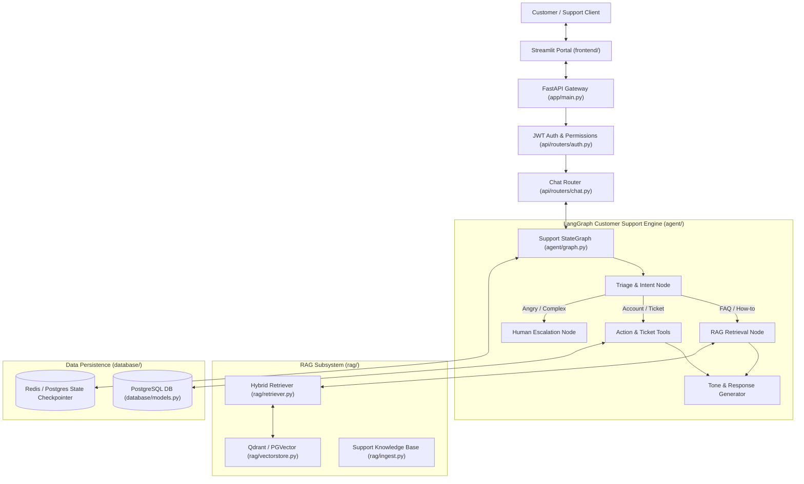

# AI Customer Support Agent (LangGraph + FastAPI + RAG)

[](https://www.python.org/downloads/)
[](https://langchain-ai.github.io/langgraph/)
[](https://fastapi.tiangolo.com/)
[](https://www.docker.com/)

A modular, production-grade AI Customer Support Agent platform built with **LangGraph**, **FastAPI**, **RAG (Retrieval-Augmented Generation)**, **PostgreSQL (pgvector)**, **Qdrant**, and **Streamlit**.

---

## 🏛️ Architecture Overview



---

## 📁 Directory Structure

```text
ai-support-agent/
├── app/                        # Application configuration, dependencies, and main FastAPI app
│   ├── __init__.py
│   ├── main.py                 # FastAPI application factory and lifespan events
│   ├── config.py               # Pydantic v2 application settings and env parser
│   ├── dependencies.py         # Dependency injection (DB, LangGraph, LLM, Auth)
│   └── exceptions.py           # Custom domain exceptions and error handlers
├── agent/                      # LangGraph core orchestration engine
│   ├── __init__.py
│   ├── state.py                # TypedDict / Pydantic agent state definition
│   ├── graph.py                # StateGraph workflow composition and checkpointer
│   ├── nodes.py                # Graph nodes (triage, retrieve, act, respond, escalate)
│   ├── tools/                  # Agent tools (Ticket management, customer lookups, KB)
│   │   ├── __init__.py
│   │   ├── ticket_tools.py
│   │   ├── customer_tools.py
│   │   └── kb_tools.py
│   └── prompts/                # Structured prompts for each stage of reasoning
│       ├── __init__.py
│       ├── system.py
│       ├── triage.py
│       ├── response.py
│       └── escalation.py
├── rag/                        # Retrieval-Augmented Generation pipeline
│   ├── __init__.py
│   ├── ingest.py               # Document loader, chunking, and vector embedding pipeline
│   ├── retriever.py            # Hybrid & dense retrieval logic
│   └── vectorstore.py          # Vector store clients (Qdrant & PGVector adapters)
├── database/                   # Relational database persistence
│   ├── __init__.py
│   ├── models.py               # SQLAlchemy ORM schemas (Customers, Tickets, Messages)
│   ├── session.py              # Async database engine & session maker
│   ├── crud.py                 # Database access operations
│   └── migrations/             # Alembic migration environment and version scripts
├── api/                        # HTTP REST API layer
│   ├── __init__.py
│   ├── schemas.py              # Pydantic schemas for requests, responses & events
│   └── routers/                # Sub-routers
│       ├── __init__.py
│       ├── chat.py             # Chat turn & streaming endpoints
│       ├── tickets.py          # Customer support ticket lifecycle endpoints
│       ├── customers.py        # Customer profile & account lookups
│       └── auth.py             # User authentication and JWT tokens
├── frontend/                   # Streamlit interactive UI
│   ├── __init__.py
│   ├── app.py                  # Multi-page Streamlit customer support app
│   └── components.py           # Chat UI widgets & customer sidebar components
├── tests/                      # Automated test suite
│   ├── __init__.py
│   ├── conftest.py             # Pytest fixtures and mock dependencies
│   ├── test_agent.py           # LangGraph graph execution tests
│   ├── test_rag.py             # Ingestion & retrieval verification
│   ├── test_api.py             # FastAPI integration tests
│   └── test_database.py        # ORM model & CRUD tests
├── scripts/                    # Utility and management scripts
│   ├── __init__.py
│   ├── seed_db.py              # Populates test customers, tickets, and FAQs
│   ├── run_ingest.py           # CLI script to embed knowledge base documents
│   └── evaluate_agent.py       # Evaluation and benchmarking harness
├── docker/                     # Docker configurations
│   ├── docker-compose.dev.yml  # Development compose with hot-reload
│   ├── docker-compose.prod.yml # Production compose with replicas
│   └── entrypoint.sh           # Container startup hook
├── docs/                       # Project documentation
│   ├── architecture.md         # Detailed LangGraph state transitions
│   ├── api_reference.md        # API endpoints documentation
│   └── deployment.md           # Kubernetes and cloud deployment guide
├── .env.example                # Template of all required environment variables
├── .gitignore                  # Git ignore rules
├── .dockerignore               # Docker ignore rules
├── Dockerfile                  # Multi-stage production container build
├── docker-compose.yml          # Top-level Docker Compose file
├── pyproject.toml              # Poetry and build tool configurations
├── requirements.txt            # Pinned requirements file
└── README.md                   # This project guide
```

---

## 🚀 Quickstart Guide

### 1. Prerequisites
- Python 3.11+
- Docker & Docker Compose
- OpenAI API Key (or alternative LLM provider key)

### 2. Local Setup

```bash
# Navigate to project
cd ai-support-agent

# Create virtual environment
python -m venv .venv

# Activate virtual environment
# Windows:
.venv\Scripts\activate
# Linux/macOS:
source .venv/bin/activate

# Install dependencies
pip install -r requirements.txt
# Or using Poetry:
# poetry install
```

### 3. Environment Setup

```bash
# Copy example environment configuration
cp .env.example .env

# Edit .env and configure your secrets (OPENAI_API_KEY, DATABASE_URL, etc.)
```

### 4. Running with Docker Compose (Recommended)

Start the entire stack (FastAPI Backend, Streamlit Frontend, PostgreSQL with pgvector, Qdrant Vector Store, and Redis):

```bash
docker compose up --build
```

- **Backend API**: `http://localhost:8000`
- **Swagger Documentation**: `http://localhost:8000/docs`
- **Streamlit Chat Interface**: `http://localhost:8501`
- **Qdrant Dashboard**: `http://localhost:6333/dashboard`

---

## 🧪 Testing

Run unit and integration tests using `pytest`:

```bash
pytest -v
```

Run test suite with coverage report:

```bash
pytest --cov=app --cov=agent --cov=rag --cov=api tests/
```

---

## 🛠️ Development & Next Steps
1. Populate `rag/ingest.py` with specific PDF/Markdown ingestion logic.
2. Connect production PostgreSQL in `.env`.
3. Customize prompts in `agent/prompts/` to fit your business persona.

