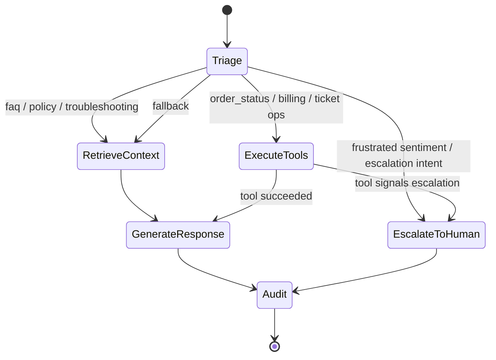

# Architecture & System Design

This document explains how the AI Customer Support Agent works internally: the LangGraph execution flow, how tool authorization is enforced, and how conversation state is managed.

---

## 1. High-Level Overview

The agent is a **LangGraph `StateGraph`** — not a free-form prompt chain. Every customer message follows a deterministic, auditable path: classify → route → act → respond → audit.



Source of truth: `agent/graph.py::create_support_graph()`.

---

## 2. Graph Nodes & Responsibilities

Every node is a plain async function `(SupportAgentState) -> Dict[str, Any]` returning a **partial state update** that LangGraph merges into the conversation state.

| Node (graph name) | Implementation | Reads | Writes | Responsibility |
|---|---|---|---|---|
| `triage` | `agent/nodes.py::intent_classifier` | `messages`, `customer_id`, `turn_count` | `intent`, `sub_intent`, `sentiment`, `urgency`, `escalation_needed`, `escalation_reason`, `confidence_score`, `turn_count` | LLM-based classification into one of 11 intents (see §4). Applies hard escalation rules (angry sentiment, escalation intents). |
| `retrieve_context` | `agent/nodes.py::retrieve_knowledge` | `messages`, `intent` | `retrieved_docs`, `tools_used` | Rewrites the query with an LLM, then runs dense/hybrid retrieval over the knowledge base. Non-fatal on failure (falls back to a stub doc). |
| `execute_tools` | `agent/tools/registry.py::execute_tools` | `messages`, `intent`, `customer_id`, `metadata.role` | `messages` (ToolMessages), `tools_used`, `customer_data`, `order_data`, `ticket_data`, `current_ticket_id`, `escalation_needed`, `retrieved_docs` | Runs pending tool calls (see §3 and §5). One broken tool never crashes the run — errors are caught per-tool. |
| `generate_response` | `agent/nodes.py::generate_response` | `messages`, `intent`, `sentiment`, `customer_data`, `retrieved_docs`, `order_data`, `ticket_data` | `final_response`, `confidence_score`, `messages` | Synthesizes the final customer-facing reply from all gathered context. |
| `escalate_to_human` | `agent/nodes.py::escalate_to_human` | `customer_data`, `current_ticket_id`, `escalation_reason`, `sentiment`, `urgency` | `escalation_needed=True`, `final_response`, `messages` | Marks the ticket escalated, generates a compassionate handoff message, and emits an internal `ESCALATION ALERT` log. |
| `audit` | `agent/nodes.py::audit_and_log` | all fields | telemetry | Records confidence, latency, and actions to the audit trail. Terminal node. |

### Observability instrumentation

Every node is wrapped by `_instrument()` in `agent/graph.py`, which adds:

- an **OpenTelemetry span** `agent.node.<name>` per node execution,
- a **Prometheus** duration observation on `support_agent_graph_node_duration_seconds`,
- propagation of session/user/ticket into the structured log context.

Similarly, each tool invocation inside `execute_tools` gets a `tool.<name>` span and `support_agent_tool_usage_total` / `support_agent_tool_duration_seconds` metrics (see `app/monitoring.py`).

---

## 3. Tool Execution & Authorization

### 3.1 How tools get called

`execute_tools` resolves pending calls in two ways:

1. **Tool-calling LLM** — the last `AIMessage` carries `tool_calls`; each is executed by name from the registry.
2. **Intent fallback** — when no tool-calling LLM is available, `_intent_fallback_calls()` maps the classified intent to a tool list (`_FALLBACK_MAP` in `registry.py`) and regex-extracts IDs (order numbers, ticket numbers) from the latest human message.

Results are appended as `ToolMessage`s and key payloads are promoted into state (`order_data`, `ticket_data`, `retrieved_docs`, …).

### 3.2 Server-side authorization

Authorization is **never delegated to the LLM**. The registry injects system arguments *after* the LLM has produced its call (`_system_injected_args()` in `registry.py`):

- `requesting_customer_id` — always taken from `state["customer_id"]`, never from the LLM.
- `role` — taken from `state["metadata"]["role"]`.

Every tool in `agent/tools/` then enforces the shared rules from `agent/tools/base.py`:

| Caller | Access rule |
|---|---|
| `customer` | May only read/mutate resources whose `customer_id` matches their own (`is_authorized()`). |
| `support_agent` / `admin` / `staff` (`STAFF_ROLES`) | May act on any customer's records. |
| anonymous (no id) | Always denied for customer-scoped resources (`deny()`). |

A denied call returns the canonical structured payload:

```json
{ "success": false, "authorized": false, "error": "Permission Denied: you are not authorized to perform 'get_order_status'." }
```

### 3.3 Tool result contract

Every tool returns a dict with at least `success: bool`:

```json
{ "success": true, "order": { ... } }
{ "success": false, "error": "'get_order_status' failed. Please try again or contact support." }
```

Raw exceptions are never leaked to the LLM — unexpected errors go through `tool_error()`. Every invocation is also written to the `agent_action_logs` audit table via `audit_log()` (best-effort; audit failure never breaks the tool).

### 3.4 Registry

`agent/tools/registry.py` is the single registration point. `register_all()` (idempotent) imports and registers:

`search_knowledge_base`, `get_customer_info`, `get_order_status`, `create_support_ticket`, `update_ticket_status`, `draft_followup_email`, `escalate_ticket`, `get_ticket_history`.

To add your own tool, see [ADDING_TOOLS.md](ADDING_TOOLS.md).

---

## 4. Intent Taxonomy & Routing

The canonical intent set lives in `agent/state.py` and is shared by prompts, nodes, and routing:

| Intent | Route after triage |
|---|---|
| `faq`, `policy`, `troubleshooting` | → `retrieve_context` (RAG) |
| `order_status`, `billing`, `account_update`, `ticket_lookup` | → `execute_tools` |
| `ticket_create`, `ticket_update`, `email_draft` | → `execute_tools` |
| `escalation_request`, `complaint` | → `escalate_to_human` |
| `general_inquiry` / anything else | → `retrieve_context` (safe default) |

**Automatic escalation triggers** (checked in `route_after_triage` and `intent_classifier`):

- `state["escalation_needed"]` is already set, or
- classified sentiment is in `ESCALATING_SENTIMENTS` (`angry`, `very_frustrated`), or
- intent is in `ESCALATION_INTENTS` (`escalation_request`, `complaint`), or
- the LLM sets `escalation_required: true` in its triage JSON, or
- confidence falls below `CONFIDENCE_THRESHOLD` (settings), or
- turn count exceeds `MAX_AGENT_TURNS`.

Routing after tools: `route_after_tools()` sends the flow to `escalate_to_human` if `escalation_needed` was set during tool execution (e.g. a successful `escalate_ticket` call), otherwise to `generate_response`.

---

## 5. State Management

### 5.1 `SupportAgentState`

Defined in `agent/state.py` as a `TypedDict` — the single source of truth for all data flowing through the graph.

- **`messages`** uses the built-in **`add_messages` reducer**: nodes append messages without overwriting the full history.
- **All other fields** use the default *replace* reducer (last-write wins) — correct for scalars that nodes mutate one at a time.
- Optional fields default to `None` / `[]` / `{}` so nodes can execute in any order without `KeyError`.

Key fields:

| Field | Purpose |
|---|---|
| `messages` | Full LangChain message history (`HumanMessage`, `AIMessage`, `ToolMessage`) |
| `session_id`, `customer_id` | Thread and identity keys (thread_id drives the checkpointer) |
| `intent`, `sub_intent`, `sentiment`, `urgency` | Triage output |
| `escalation_needed`, `escalation_reason` | Escalation signal consumed by routing |
| `tools_used` | Growing list of tool/node names executed this session |
| `customer_data`, `order_data`, `ticket_data` | Tool results promoted into prompt context |
| `current_ticket_id` | Active ticket for follow-up operations |
| `retrieved_docs` | RAG results with scores & metadata |
| `final_response`, `confidence_score`, `turn_count` | Response generation output |

Initial state is created by `agent/state.py::initial_state(session_id, customer_id)`.

### 5.2 Checkpointing

- **Development/tests**: `MemorySaver()` (in-process, keyed by `thread_id = session_id`).
- **Production**: swap in `AsyncPostgresSaver` or `RedisSaver` so state survives across workers and restarts. The checkpointer is a parameter of `create_support_graph(checkpointer=...)`; the chat router currently keeps a process-level `MemorySaver` — see the TODO in `api/routers/chat.py`.

Conversation history is served from the checkpointer by `GET /api/v1/chat/{session_id}/history` and cleared by `DELETE /api/v1/chat/{session_id}`.

---

## 6. RAG Subsystem

- **Ingestion** (`rag/ingest.py`): loads `.md` / `.txt` / `.pdf` / `.html` from a docs directory → `RecursiveCharacterTextSplitter` (default chunk 1000 / overlap 200) → embeddings → vector index. Runnable as a CLI (`python -m rag.ingest`) or via `POST /api/v1/rag/ingest`.
- **Vector store** (`rag/vectorstore.py`): FAISS (local, default), pgvector, or Qdrant — selected by `VECTORSTORE_BACKEND`.
- **Retrieval** (`rag/retriever.py`): `SupportKBRetriever` with `TOP_K_RETRIEVAL`, `SIMILARITY_THRESHOLD`, optional doc-type filters, and optional hybrid BM25 + vector search.

---

## 7. API & Cross-Cutting Concerns

- **App factory + lifespan** (`app/main.py`): compiles the graph once, initializes the observability stack, ensures DB schema in dev.
- **Middleware** (`app/middleware.py`): every request gets an `X-Request-ID` (honours incoming header), echoed on responses; errors return uniform JSON envelopes including the `request_id`.
- **Auth** (`app/security.py`): JWT access + refresh tokens; role guards via `require_roles(...)`. Roles: `customer`, `support_agent`, `admin`.
- **Observability** (`app/monitoring.py`): structured JSON logs, OTel traces, Prometheus `/metrics`, LangSmith, Sentry — all optional and fail-safe. See the observability section of the [README](../README.md#-observability).

---

## 8. Extension Points

| Want to… | Do this |
|---|---|
| Add a tool | [docs/ADDING_TOOLS.md](ADDING_TOOLS.md) |
| Change routing | Edit `route_after_triage` / `route_after_tools` in `agent/graph.py` and the intent constants in `agent/state.py` |
| Change persona/tone | Edit `agent/prompts/*.py` |
| Add a new intent | Add constant + `ALL_INTENTS` entry in `agent/state.py`, teach the triage prompt, add routing + fallback tool map |
| Persist state across workers | Provide a Redis/Postgres checkpointer to `create_support_graph()` |
