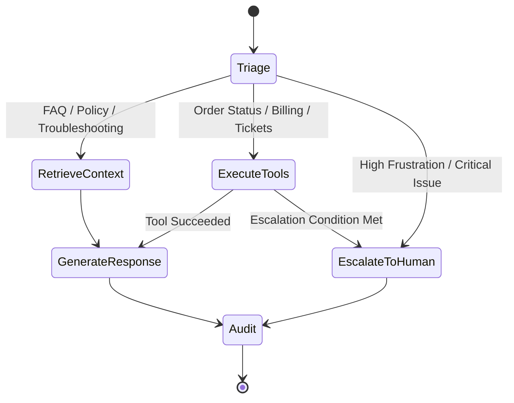

# Architecture & System Design

## 1. High-Level Overview

The AI Customer Support Agent is designed around a multi-stage **StateGraph** built with **LangGraph**. Unlike naive prompt chains, the state graph provides deterministic control over when tools are triggered, when context is retrieved, and when humans must intervene.

## 2. Graph Nodes & Responsibilities

| Node Name | Function | Responsibilities |
| :--- | :--- | :--- |
| `triage` | `triage_and_classify_node` | Evaluates sentiment, user intent category, and determines whether human escalation is triggered immediately. |
| `retrieve_context` | `retrieve_context_node` | Performs hybrid vector + keyword retrieval on Qdrant / PGVector knowledge base. |
| `execute_tools` | `execute_tools_node` | Executes backend actions (e.g. database customer order lookups, support ticket creations). |
| `generate_response` | `generate_response_node` | Synthesizes final response adhering to company brand tone and policy guidelines. |
| `escalate_to_human` | `escalate_to_human_node` | Generates a Tier-2 support handoff ticket and compassionate customer notice. |
| `audit` | `post_process_and_audit_node` | Logs telemetry, confidence scores, and token latency to database audit logs. |

## 3. State Management & Checkpointing

- **State Schema**: Central `SupportAgentState` (TypedDict) retains conversational messages using `add_messages` reducer, tracking customer metadata, active ticket code, and confidence scores.
- **Checkpointer**: Development uses `MemorySaver()`. Production integrates with Redis or PostgreSQL checkpointers via `thread_id` session keys.

