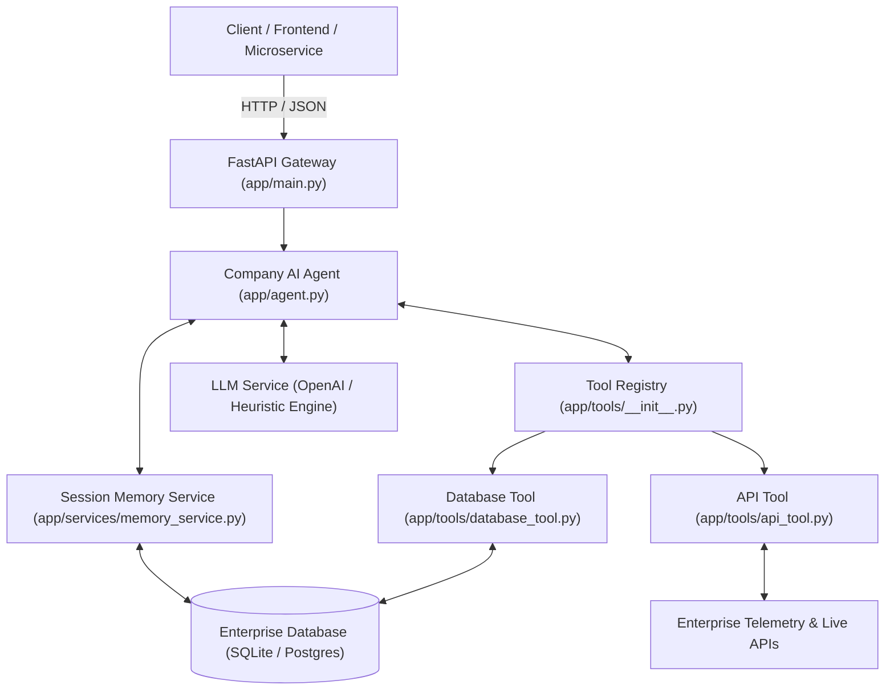

# Company AI Agent 🤖

[](https://www.python.org/)
[](https://fastapi.tiangolo.com/)
[](https://www.docker.com/)
[](https://github.com/)

An enterprise-grade, autonomous AI Agent service powered by **FastAPI**, **LangChain/OpenAI ReAct reasoning**, **dynamic tool calling**, and **persistent multi-turn conversation memory**.

---

## 🏛️ System Architecture



---

## 📁 Project Structure

```text
company-ai-agent/
├── app/
│   ├── __init__.py               # Package metadata and version definition
│   ├── main.py                   # FastAPI REST API endpoints & lifecycle handlers
│   ├── agent.py                  # Core ReAct reasoning loop & tool orchestrator
│   ├── config.py                 # Pydantic Settings & environment variables
│   ├── prompts.py                # System instructions, safety rules & prompt templates
│   ├── models.py                 # SQLAlchemy ORM models & database seeder
│   ├── schemas.py                # Pydantic schemas for requests, responses & tools
│   ├── tools/
│   │   ├── __init__.py           # BaseTool interface & ToolRegistry dispatcher
│   │   ├── database_tool.py      # Read-only SQL tool for employees, tickets, & policies
│   │   └── api_tool.py           # HTTP client tool for live telemetry & external APIs
│   └── services/
│       ├── llm_service.py        # OpenAI tool-calling & heuristic fallback engine
│       └── memory_service.py     # Persistent multi-turn conversation session history
├── tests/
│   ├── test_agent.py             # Agent reasoning, tool dispatch & memory tests
│   └── test_api.py               # FastAPI integration endpoint tests
├── .env.example                  # Environment variable template with documentation
├── .gitignore                    # Comprehensive Git ignore rules
├── requirements.txt              # Pinned Python package dependencies
├── Dockerfile                    # Multi-stage production container definition
├── docker-compose.yml            # Docker Compose configuration with healthchecks
├── .dockerignore                 # Docker build exclusions
├── README.md                     # Comprehensive architecture and operations guide
└── .github/workflows/deploy.yml  # CI/CD linting, testing, and deployment pipeline
```

---

## ✨ Key Features

1. **Autonomous Reasoning & Dynamic Tool Calling**:
   - Implements multi-iteration ReAct loop (Reasoning + Acting).
   - Dynamically selects and invokes tools, processes tool outputs, and synthesizes answers.
2. **Enterprise Database Tool**:
   - Accesses employee directory, IT support tickets, and corporate policies.
   - Built-in SQL safety guardrails: strictly enforces read-only operations and prevents destructive queries (`DROP`, `DELETE`, `UPDATE`, `INSERT`).
3. **Enterprise Telemetry & API Tool**:
   - Queries system health, cluster status, microservice latencies, and currency exchange rates.
4. **Persistent Session Memory**:
   - Multi-turn conversation threading per `session_id`.
   - History retention with sliding context windows.
5. **Zero-Configuration Fallback (Heuristic Engine)**:
   - When no `OPENAI_API_KEY` is provided, the agent automatically switches to an intelligent local reasoning engine, allowing offline testing and immediate container startup.

---

## 🚀 Getting Started

### 1. Clone & Set Up Environment

```bash
cd company-ai-agent

# Create Python virtual environment
python -m venv .venv

# Activate virtual environment
# Windows:
.venv\Scripts\activate
# Linux/macOS:
source .venv/bin/activate

# Install dependencies
pip install -r requirements.txt
```

### 2. Configure Environment

Copy the example environment file:

```bash
cp .env.example .env
```

Edit `.env` to configure your settings:
- Provide your `OPENAI_API_KEY` (optional; leave blank to run in mock/heuristic mode).
- Specify `OPENAI_MODEL` (e.g. `gpt-4o-mini`, `gpt-4o`).

### 3. Run Application Server

```bash
uvicorn app.main:app --host 0.0.0.0 --port 8000 --reload
```

The server will be available at:
- **API Base**: `http://localhost:8000`
- **Swagger Documentation**: `http://localhost:8000/docs`
- **ReDoc Documentation**: `http://localhost:8000/redoc`

---

## 🐳 Docker Deployment

### Using Docker Compose:

```bash
# Build and run
docker compose up --build -d

# Check service logs
docker compose logs -f

# Verify container health
docker compose ps
```

### Using Standalone Docker:

```bash
# Build Docker image
docker build -t company-ai-agent:latest .

# Run Docker container
docker run -p 8000:8000 --env-file .env company-ai-agent:latest
```

---

## 🔌 API Endpoints Reference

| Method | Endpoint | Description |
| :--- | :--- | :--- |
| `GET` | `/` | Service status and metadata |
| `GET` | `/health` | Deep healthcheck (Agent, Database, LLM) |
| `POST` | `/api/v1/chat` | Execute an AI agent conversation turn |
| `GET` | `/api/v1/sessions` | List active conversation sessions |
| `GET` | `/api/v1/sessions/{id}/history` | Retrieve full history for a session |
| `DELETE` | `/api/v1/sessions/{id}` | Clear message history for a session |
| `GET` | `/api/v1/tools` | Inspect registered agent tools and schemas |

### Example Chat Request:

```bash
curl -X POST "http://localhost:8000/api/v1/chat" \
     -H "Content-Type: application/json" \
     -d '{
       "message": "Find all open high priority tickets and who is assigned to them.",
       "session_id": "session_demo_01"
     }'
```

### Example Chat Response:

```json
{
  "session_id": "session_demo_01",
  "answer": "Based on the enterprise database records, here are the high-priority tickets...",
  "tools_used": ["database_tool"],
  "steps": [
    {
      "step_number": 1,
      "thought": "Inspecting active IT support and engineering tickets in the database.",
      "tool_call": {
        "id": "call_42a8b9e1",
        "tool_name": "database_tool",
        "arguments": {"action": "search_tickets", "priority": "High"},
        "result": [...]
      }
    }
  ],
  "iterations": 1,
  "timestamp": "2026-10-31T12:00:00Z"
}
```

---

## 🧪 Running Automated Tests

Run the full pytest suite:

```bash
pytest -v
```

Run test suite with detailed output and coverage:

```bash
pytest --verbose --tb=short tests/
```

---

## 🔒 Security & Guardrails

- **SQL Injection Prevention**: All raw SQL queries are parsed and checked against a strict denylist. Non-SELECT statements are rejected before reaching the database.
- **Least Privilege Execution**: Docker runs under a non-root system user (`appuser`).
- **Prompt Injection Defense**: System instructions enforce role boundaries and prevent leaking configuration secrets.

